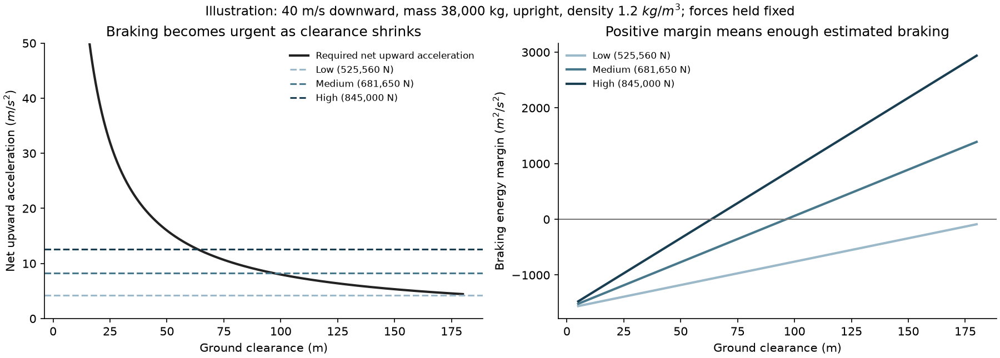
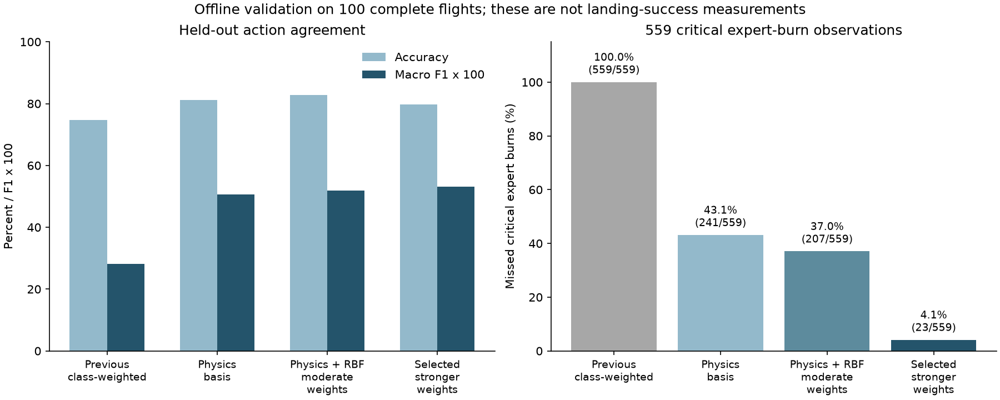

# Physics-informed rocket action classifier

Design, intuition, training and validation report for `mymodel.py`, feature version 5.

## 1. The main idea

The scaffold asks a linear classifier to select an action from the rocket's raw state. My central intuition was that the state should first be expressed in terms of the decisions the controller needs to make:

- How much clearance remains before the body touches the ground?
- How much upward acceleration is needed to slow the descent?
- Which available throttle levels can provide that acceleration?
- Where will horizontal drift take the rocket, and which tilt and gimbal correction would oppose it?
- How should those corrections change between a high approach and the last few metres?

These questions involve products, squares, ratios, angles and changes of flight phase. A linear combination of the original observations cannot directly express most of them. The model therefore constructs nonlinear **basis features**, then learns a linear softmax classifier on those features.

The physics supplies useful coordinates for learning. It does not directly select the thrust or run the expert controller. The action weights are learned from the labelled demonstrations.

This distinction matters: the model has improved substantially at imitating the expert on held-out flights, but its landing success has not been measured for this version. It is not a perfect controller, and some starting states are physically unrecoverable.

## 2. Comparison with the scaffold

The original implementation is [scaffold.py](scaffold.py), with the original training workflow in [train.ipynb](train.ipynb). The corresponding updated files are [mymodel.py](mymodel.py) and [mytrain.ipynb](mytrain.ipynb).

| Aspect | Original scaffold/workflow | Current model/workflow | Reason for the change |
|---|---|---|---|
| Inputs to the learned mapping | 12 observations and a bias | 124 observation/physics/polynomial features, 160 RBF features and a bias | Express braking, steering and local nonlinear decisions |
| Learned output | Linear scores followed by softmax | Linear scores followed by softmax, with reflected-score averaging | Retain an interpretable classifier while increasing the representation's capacity |
| Normalization | Recomputed whenever the design matrix is built | Fitted on training observations and their mirrored copies, then frozen | Make training, validation and single-observation prediction use the same coordinates |
| Wind | Available as two raw inputs | Enters air-relative speed, aerodynamic force and torque calculations | Capture its nonlinear physical effects |
| Left/right structure | Learned only from available examples | Mirrored training data and symmetric inference | Avoid learning separate, inconsistent solutions for reflected situations |
| Training loss | Ordinary cross-entropy | Class-weighted cross-entropy with L2 regularization | Give uncommon actions more influence while controlling large coefficients |
| Optimizer | Full-batch gradient descent with a fixed step | Full-batch limited-memory BFGS with backtracking | Handle correlated, differently curved feature directions more effectively |
| Stopping | Fixed number of epochs | Iteration limit plus validation patience, gradient and line-search checks | Retain the best observed validation checkpoint |
| Data split | Random individual rows | Complete flights grouped by `run_id` | Prevent adjacent states from one flight appearing on both sides of a split |
| Model choice | One chosen learning rate and epoch count | Three explicit candidate configurations | Compare representation and class-balancing choices |
| Evaluation | Loss curves; metric helpers defined but not used | Accuracy, macro F1, per-action reports, confusion matrices and critical-burn diagnostics | Expose errors hidden by overall accuracy |
| Saved model | Weights and basic training/normalization fields | Also saves feature version, RBF state, class weights, hyperparameters and stopping metadata | Reproduce the same inference transformation after loading |

### An essential correctness fix: normalization

In the scaffold, `_create_design_matrix` calculates a new mean and standard deviation on every call. With a single observation, every feature equals its own mean. Consequently, all normalized features become zero and only the bias remains. The deployed controller then cannot distinguish different single observations.

Even batch validation has a related problem: its features are expressed relative to validation-set statistics, whereas the weights were fitted using training-set statistics.

The current model calculates statistics during fitting only. Prediction reuses those stored statistics. This is a correctness fix separate from improvements in model capacity. Saving means and standard deviations is useful only if prediction actually reuses them.

## 3. What remains a linear classifier

For a feature vector \(\phi(s)\), the basic class scores are

\[
z_a(s)=\phi(s)^T W_a,
\qquad
p(a\mid s)=\frac{\exp z_a(s)}{\sum_b\exp z_b(s)}.
\]

The selected model has 285 design-matrix columns and ten action columns, giving 2,850 learned coefficients. The feature construction is nonlinear in the observations, but the scores remain linear in the learned coefficients. RBF centres and their width are fixed before coefficient optimization; they are not trained hidden-layer weights.

There is no neural network, trajectory integrator or MPC solver inside inference. The uploaded model depends on NumPy. The notebook uses additional packages for data analysis, metrics and plotting.

The action representation follows the exercise:

| Action | Throttle command | Gimbal command |
|---|---:|---:|
| 0 | Off | Centred |
| 1, 2, 3 | Low: 0.12 | +1, 0, -1 |
| 4, 5, 6 | Medium: 0.55 | +1, 0, -1 |
| 7, 8, 9 | High: 1.00 | +1, 0, -1 |

For a powered engine, the simulator converts throttle to thrust using

\[
T=482000+363000u\quad\text{N}.
\]

Thus low, medium and high provide 525,560 N, 681,650 N and 845,000 N respectively. Low throttle is not 12% of maximum thrust: the minimum-thrust offset is important when estimating braking capability.

## 4. Physics as information for the classifier

### 4.1 Mass, centre of mass and inertia

Fuel affects more than the number of seconds the engine can run. It changes acceleration for the same thrust, the centre of mass and resistance to angular acceleration.

The model uses the exercise's dry mass of 28,000 kg and its fuel-tank geometry. For remaining fuel \(f\),

\[
m=28000+f,
\qquad
h_f=39f/411000,
\qquad
c_f=5+h_f/2,
\]

\[
c=\frac{28000\times23+fc_f}{m}.
\]

The moment of inertia combines the calibrated dry inertia, the cylindrical fuel inertia and parallel-axis terms. These quantities are used internally to calculate acceleration, ground clearance and steering authority. They are not additional learned parameters.

The relevant calibration also includes gravity 9.80665 m/s², reference area 10.5209 m², rocket length 48.768 m, engine position 1 m along the body axis, centre of pressure at 37 m, and a maximum gimbal angle of 5 degrees.

### 4.2 Ground clearance rather than centre-of-mass height

The observation `y` measures centre-of-mass height. The rocket touches the ground while its centre of mass is still well above zero.

For every hull vertex and landing foot, the model rotates its offset from the centre of mass into world coordinates. The minimum vertical coordinate above a flat pad defines clearance. Including the hull matters at large tilt, where a body part can be lower than either foot.

This makes the braking calculation answer “how much distance remains before contact?” rather than “how far is the centre of mass above zero?” Negative clearance is clipped to zero to keep the subsequent feature calculations finite.

This calculation assumes a flat pad at zero elevation. It does not reproduce the simulator's piecewise terrain outside the pad.

### 4.3 Why wind must enter through forces

The rocket's velocity relative to the air is

\[
v_{rx}=v_x-w_x,\qquad v_{ry}=v_y-w_y.
\]

A linear model can already form these two differences from the original inputs. Adding the differences alone therefore does not expand its expressive power. The useful additional information comes from what the physics does with them.

The aerodynamic calculation uses airspeed, angle of attack, density, drag and lift:

\[
C_D=0.65+15\sin^2\alpha,
\qquad
C_L=-0.60\sin(2\alpha),
\qquad
qA=\tfrac12\rho\lVert v_r\rVert^2 A.
\]

Drag opposes air-relative velocity; lift is perpendicular to it. The force at the centre of pressure also produces torque, and the model includes the calibrated angular damping term. Thrust direction depends on tilt plus gimbal angle. Dividing total force by mass and total torque by inertia gives the instantaneous accelerations.

`_accelerations` includes these effects. When constructing the new decision features, it is evaluated with the engine off to isolate aerodynamic acceleration and gravity. Candidate thrust levels can then be added without accidentally counting the current engine thrust twice.

These are instantaneous force calculations. They do not integrate a future trajectory or assume that a future control sequence is known.

### 4.4 Vertical braking demand

Let \(h\) be clearance and \(d=\max(-v_y,0)\) downward speed. For a target descent speed \(v_*=0.8\) m/s, the constant-acceleration braking estimate is

\[
a_{\mathrm{req}}=
\max\left(\frac{d^2-v_*^2}{2\max(h,0.5)},0\right).
\]

The intuition is straightforward: twice the downward speed means approximately four times the distance is needed for the same braking acceleration. As clearance shrinks, the acceleration needed to achieve a soft touchdown rises rapidly.

The corresponding approximate thrust demand is

\[
T_{\mathrm{req}}=
\frac{m(a_{\mathrm{req}}-a_{y,\mathrm{coast}})}{\max(\cos\theta,0.25)}.
\]

The coast acceleration already includes gravity and the aerodynamic vertical force. The cosine term accounts approximately for the loss of vertical thrust when tilted.

The 0.8 m/s target leaves margin below the exercise's 3 m/s descent limit. It is an engineering choice, not a learned optimum or a guarantee. The 0.5 m clearance floor and cosine floor avoid unstable divisions; they make the feature approximate in extreme situations.

The figure holds the observed state and aerodynamic force fixed. It illustrates the feature equations and does not represent a simulated landing.

### 4.5 Comparing all three powered throttle levels

A maximum-thrust stopping estimate only asks whether a strong enough burn might work. The classifier also needs to distinguish low, medium and high thrust. For each level \(j\), it estimates

\[
a_j=a_{y,\mathrm{coast}}+T_j\cos\theta/m.
\]

Four features are constructed for each level:

| Feature | Meaning and reason for inclusion |
|---|---|
| `*_energy_margin` | \(2a_jh-\max(d^2-v_*^2,0)\): positive means enough estimated braking distance; negative means a shortfall. A signed logarithm compresses the magnitude while preserving the sign. |
| `*_speed_margin` | \(\sqrt{v_*^2+2\max(a_j,0)h}-d\): compares current descent speed with the approximate speed that could be reduced to the target over the remaining clearance. |
| `*_thrust_error` | Required thrust minus the level's thrust, divided by the calibrated thrust range: expresses whether that level is below or above the estimated demand. |
| `*_cannot_brake` | Indicates nonpositive net upward acceleration: separates a physically ineffective braking level from one that merely needs more time. |

These are related views of the same problem, deliberately making useful threshold decisions accessible to the linear output layer. They should not be interpreted as twelve independent physical discoveries.

### 4.6 Horizontal drift, tilt and rotation

Horizontal position alone cannot tell the controller which way to steer. A rocket right of the pad and moving left quickly may require a different correction from one at the same position moving right.

The model estimates time remaining as

\[
\tau=\operatorname{clip}\left(\frac{2h}{\max(d+0.8,1)},0.25,15\right).
\]

This comes from an approximate average descent speed between the current speed and the target touchdown speed. It is a bounded estimate, not the exact solution of the powered landing dynamics. Steering uses \(\tau_s=\max(\tau,1.5)\) to prevent very small clearance from demanding arbitrarily fast attitude changes.

An approximate lateral acceleration request is

\[
a_{x,\mathrm{req}}=\operatorname{clip}\left(
-\frac{2(x+v_x\tau_s)}{\tau_s^2},-4,4\right).
\]

It corrects the projected position, combining position and velocity. The model then estimates a tilt that would produce this horizontal correction while supporting the estimated vertical demand. Aerodynamic horizontal acceleration is accounted for. The tilt request is clipped to ±0.25 rad.

The tilt error and angular velocity then define an angular acceleration request. Comparing that request with aerodynamic angular acceleration and estimated maximum-thrust gimbal authority produces `gimbal_request`.

This gives the classifier a physically meaningful indication of which steering correction is needed. It is still a feature: the requested value is not sent directly to the engine. Its limits, the minimum steering horizon and its use of maximum-thrust authority are approximations, not an optimized guidance law.

## 5. Why every feature family is included

The complete representation has the following inventory:

| Family | Number of columns |
|---|---:|
| Original observations | 12 |
| Additional geometry, dynamics and guidance features | 21 |
| Four braking comparisons for each of three throttle levels | 12 |
| Three approach gates, each with seven gated quantities | 24 |
| Quadratic terms from ten core quantities | 55 |
| RBF features | 160 |
| Bias | 1 |
| **Total** | **285** |

### 5.1 Keeping the original observations

The physics calculations are approximate. Keeping all 12 inputs allows the learned classifier to correct systematic errors and use information not captured by the engineered features.

| Observations | Why retained |
|---|---|
| `x`, `y` | Original position and height context, including information beyond the clearance estimate |
| `vx`, `vy` | Actual ground-relative motion, rather than only projected or transformed motion |
| `theta`, `omega` | Current attitude and rotational motion, which can require immediate correction |
| `fuel_mass` | Remaining control capability and the mass-dependent response to thrust |
| `actual_thrust`, `actual_gimbal` | Current actuator state, which can distinguish a coast from an ongoing burn |
| `wind_x`, `wind_y`, `air_density` | Environmental context and a way to learn corrections to the aerodynamic approximation |

Current actuator values are observations available at inference, so their inclusion does not use the future action label. However, over-reliance on the previous actuator setting could encourage action persistence. The new braking features and the RBF descriptor reduce the need to use actuator state as a shortcut.

### 5.2 The 21 additional state and guidance features

The names below correspond directly to `_physics_features`.

| Feature | Intuition |
|---|---|
| `clearance` | Remaining distance to body/foot contact |
| `log_clearance` | Distinguishes the last few metres without letting large heights dominate |
| `sqrt_clearance` | Represents the square-root relationship between braking speed and distance |
| `descent_speed` | Isolates downward motion; ascent should not be treated as a descent requiring braking |
| `coast_ay` | Vertical acceleration already supplied by gravity and aerodynamics |
| `aero_ax` | Lateral aerodynamic disturbance to oppose or account for |
| `aero_alpha` | Aerodynamic rotational acceleration, including damping |
| `required_ay` | Estimated net upward acceleration needed for a soft touchdown |
| `required_thrust` | Converts braking demand into the actuator's physical units |
| `time_left` | Approximate urgency and available correction time |
| `target_tilt` | Attitude suggested by the lateral and vertical correction demands |
| `tilt_error` | Difference between current and requested attitude |
| `gimbal_request` | Approximate steering demand after accounting for aerodynamic torque |
| `angular_momentum_error` | A rate-like error combining angular velocity and tilt error divided by steering time; despite the code name, this is not physical angular momentum \(I\omega\) |
| `projected_x` | Where current lateral velocity would carry the rocket over the estimated remaining time |
| `projected_tilt` | Short-horizon attitude estimate using current rotation, with the horizon capped at 3 s |
| `target_vy_error` | Difference from a descent-speed envelope based on clearance and estimated maximum braking |
| `ascent` | Explicit positive vertical speed, helping distinguish unwanted climb from a braking descent |
| `engine_on` | A discrete indicator of coast versus powered flight |
| `sin_tilt` | The nonlinear attitude component affecting horizontal thrust |
| `sin_aoa` | A regularized angle-of-attack indicator linking wind-relative flow to aerodynamics |

Several of these features overlap. That is intentional: a small, regularized linear classifier can benefit from multiple useful views of a difficult decision boundary. This is an overcomplete representation, not a claim that every column has been individually proven necessary.

### 5.3 Smooth approach gates

The same lateral correction can be appropriate at high altitude and dangerous close to contact. A fixed coefficient on tilt or velocity cannot express that change by itself.

The model creates three smooth gates,

\[
g_H(h)=\frac{H}{h+H},\qquad H\in\{5,20,80\}\ \text{m}.
\]

Each approaches one near the ground and falls gradually with height. Each gate is included alone and multiplied by horizontal velocity, tilt, angular velocity, horizontal position, gimbal request, thrust request and vertical velocity. This gives 24 features.

These gates allow the learned decision boundaries to vary with approach phase without introducing abrupt altitude switches or a hidden phase variable.

### 5.4 Quadratic interactions

The model includes all squares and pairwise products of ten scaled quantities:

| Index in `interaction_i_j` | Quantity |
|---:|---|
| 0 | Horizontal position |
| 1 | Horizontal velocity |
| 2 | Vertical velocity |
| 3 | Tilt |
| 4 | Angular velocity |
| 5 | Required thrust |
| 6 | Gimbal request |
| 7 | Log clearance |
| 8 | Current thrust |
| 9 | Estimated time left |

There are \(10\times11/2=55\) terms. For example, a tilt–thrust interaction helps distinguish the consequences of being tilted during a weak burn and a strong burn. Position–velocity interactions help distinguish motion toward the pad from motion away from it. Squares permit different treatment of large errors even when their signs differ.

These terms expand the representational capacity; L2 regularization and validation help control the corresponding risk of overfitting.

### 5.5 Local RBF features

Physics features and quadratic terms express broad relationships. They may still miss local differences between similar approach states. An RBF supplies a smooth local feature:

\[
\phi_k(s)=\exp\left(-\frac{\lVert z(s)-c_k\rVert^2}{2\sigma^2}\right).
\]

The ten-dimensional descriptor \(z\) represents horizontal position and velocity, vertical velocity, tilt, angular velocity, log clearance, required thrust, gimbal request, remaining fuel and horizontal air-relative velocity. The quantities are scaled and standardized using training statistics. Current thrust and current gimbal are excluded from this descriptor so that proximity is not dominated by the previous command.

For the selected model, 160 centres are sampled reproducibly from the mirrored training observations: 16 from each action class. This gives uncommon actions representation that uniform sampling would often miss. Centres are actual descriptor samples; they are not k-means centres or subsequently optimized parameters.

The shared width is based on the median distance to each centre's fifth other nearest centre, with a lower bound of 0.5. The saved model's width is approximately 1.896 in standardized descriptor units.

Only training data determines the centres, width and descriptor statistics. Their selection uses training labels, but validation and test observations do not become centres.

### 5.6 Scaling, clipping and the bias

Observations first receive natural physical scales: 40 m for horizontal position, 300 m for height, 8 m/s for horizontal velocity, 50 m/s for vertical velocity, 0.1 rad for tilt and 0.03 rad/s for rotation. Fuel, thrust, gimbal, wind and density use corresponding characteristic scales. These constants are numerical design choices rather than fitted physical parameters.

The core quantities used for polynomial terms are clipped to ±4. The resulting physical feature columns are bounded to ±12, standardized using training statistics with a standard-deviation floor of 0.05, and clipped to ±20. The RBF descriptor has its own bounds and a standard-deviation floor of 0.15. RBF outputs already lie between zero and one.

The floors prevent nearly constant columns from amplifying tiny variations. Clipping limits the numerical influence of extreme observations, but it also discards distinctions outside the retained ranges. It is not a safety guarantee. The bias provides an action preference when other features provide little evidence, and is excluded from L2 regularization.

## 6. Symmetry and explicit action rules

The calibrated setup has a useful reflection symmetry. A leftward situation should correspond to a rightward situation with the same vertical motion, mass and density.

Mirroring changes the signs of `x`, `vx`, `theta`, `omega`, `actual_gimbal` and `wind_x`. It leaves the other observations unchanged. Action pairs 1↔3, 4↔6 and 7↔9 swap; actions 0, 2, 5 and 8 stay fixed.

Training includes both the original and reflected examples. This doubles the number of rows presented to the optimizer, but it does not create new independent flights. It supplies a physical invariance instead of asking the model to infer it from a finite sample.

At inference, the model evaluates both views, maps the mirrored action scores back to the original frame, averages the **scores**, and then applies softmax. This is not an average of probabilities. It enforces reflection-consistent scores even if the sampled RBF centres are not themselves arranged in exact mirrored pairs.

Two explicit rules modify the final selected action:

- If fuel is exhausted, choose engine-off action 0.
- If horizontal position, horizontal velocity, tilt, rotation, gimbal and horizontal wind are all effectively zero, replace a powered gimbal choice with the centred-gimbal action at the same throttle level. An exactly symmetric state should not start turning because of an arbitrary left/right tie.

These rules are visible in `predict`; they are not learned coefficients. `predict_proba` reports the classifier probabilities before these rules, so in these exceptional states `predict` need not equal the probability argmax. Both batch prediction and `predict_action` use the same final action rules.

## 7. Differences in training

### 7.1 Splitting by flight

The dataset contains 130,008 observations from 1,000 flights. The original notebook samples rows into an 80/10/10 split. Adjacent observations are only one control interval apart, so that split allows very similar states from one flight to appear in training and validation.

The current notebook shuffles unique `run_id` values with seed 42 and assigns whole flights:

| Split | Flights | Original observations |
|---|---:|---:|
| Training | 800 | 103,669 |
| Validation | 100 | 13,015 |
| Reserved test | 100 | 13,324 |

The training set becomes 207,338 rows after mirroring. All fitted feature statistics and RBF state use those training rows only.

`run_id` identifies the split but is not an input feature. Neither `step` nor eventual `success` is an input. In particular, `success` would reveal information unavailable during flight.

The current tuning runs did not evaluate the reserved test split. Earlier model versions had test results in the notebook history, so the precise claim is that no current-version test result is reported here, not that this dataset has never been examined before. The final test cell is now disabled by default, including during Run All.

### 7.2 Class imbalance and the objective

Action 2 appears 85,694 times, approximately 65.9% of all rows. Each high-thrust action appears fewer than 1,000 times. Ordinary average cross-entropy can therefore improve mainly by learning routine low-thrust behaviour while neglecting uncommon burns.

The current model calculates class weights from training labels after mirroring:

\[
w_c=\min\left[\left(\frac{N}{10\max(n_c,1)}\right)^\gamma,C\right].
\]

The selected configuration uses \(\gamma=0.75\) and \(C=6\). Increasing the exponent gives rare classes more influence; the cap limits extreme weights. The cap applies before overall sample-weight normalization and is not a promise that the rare/common weight ratio is at most six.

With optional per-observation weights \(s_i\), the fitted objective is

\[
\mathcal L(W)=
-\frac{\sum_i s_iw_{y_i}\log p(y_i\mid x_i)}{\sum_i s_iw_{y_i}}
+\frac{\lambda}{2}\sum_{j>0,a}W_{ja}^2.
\]

The bias row is not penalized. The selected regularization strength is \(\lambda=10^{-5}\).

The API supports extra sample weights, but the final notebook candidates do not add a separate critical-descent training multiplier. Critical-descent errors are used for diagnostics and model selection. An earlier experiment did apply such a multiplier; it is not part of the selected configuration.

Validation uses the same training-derived class weights. Its own class frequencies do not determine new weights. Separately reported validation cross-entropy, accuracy and macro F1 are unweighted comparison metrics. Class-weighted probabilities should not be assumed to be calibrated probabilities under the original class frequencies.

### 7.3 Optimization

The scaffold uses a fixed-step update based on the full training set. Its constructor defaults to learning rate 0.1 and ten epochs; the original notebook overrides these with 0.01 and 2,000 epochs.

The current implementation also uses the full training set, but applies limited-memory BFGS. It retains the most recent 12 parameter-step/gradient-change pairs to estimate useful curvature information. This is helpful because features such as clearance, log clearance, braking demand and polynomial interactions are strongly correlated.

A backtracking line search starts at a step of 1.0 and halves it, up to 20 attempts, until the objective decreases sufficiently. An unsuitable search direction falls back to the negative gradient. Additional termination checks cover a small maximum gradient and failure to find an acceptable step.

The optimizer is implemented in NumPy; it does not require SciPy at inference or training inside `Controller`. The basis is fixed before this optimization. Conditional on that basis, the training objective is a convex regularized softmax objective. This does not make the full design process optimal or prove that a finite, mixed-precision run reaches its exact minimum.

An L-BFGS iteration may evaluate the full objective multiple times during line search. Consequently, 1,000 iterations should not be compared directly with 1,000 gradient-descent epochs as equal computational work.

### 7.4 Early stopping and checkpoint restoration

After each accepted update, the model evaluates class-weighted validation cross-entropy using the same mirrored-score averaging used at inference. It stores the best actual validation checkpoint. A separate `min_delta` threshold controls when patience is reset.

The selected settings allow 1,000 iterations, patience of 60 and `min_delta=1e-5`. The saved selected model reached the 1,000-iteration limit and its best checkpoint was iteration 1,000. Early stopping was available but did not trigger in this run.

Training history includes the L2 penalty; validation history does not. The two curves also use different observations, so their absolute levels are not a pure measure of generalization gap.

### 7.5 Candidate comparison and selection

The notebook compares these configurations:

| Candidate | Representation | Class-weight exponent | L2 strength | Iteration limit / patience |
|---|---|---:|---:|---:|
| `physics_class_weighted` | 125 columns including bias | 0.50 | 0.0001 | 350 / 45 |
| `rbf_class_weighted` | 285 columns including bias | 0.50 | 0.0001 | 350 / 45 |
| `rbf_balanced` | 285 columns including bias | 0.75 | 0.00001 | 1,000 / 60 |

Each fit restores its best validation-loss checkpoint. Candidate selection then shortlists models within 0.02 of the best validation macro F1 and chooses the one with the lowest critical missed-burn rate, breaking ties by F1. This explicitly trades a small amount of global F1 for attention to the braking failures seen earlier. The tolerance is a chosen selection heuristic, not a derived flight-performance guarantee.

Weighted validation loss is useful for stopping within a configuration, but losses with different class weights are not directly comparable as the same objective. That is why model selection also examines unweighted metrics and the critical-state diagnostic.

The selected model is written to `weights.npz`, with `weights_class_weighted.npz` as a current-version alias. Previously, `weights.npz` was always the baseline, which could lead to uploading the wrong candidate. Each candidate also has its own named weights file.

## 8. Recorded validation results

The figures below come from [classifier_validation.json](classifier_validation.json), with a compact table in [classifier_tuning.csv](classifier_tuning.csv). Every current candidate used the same 800 training and 100 validation flights.

**The numerical “previous” baseline is the intermediate feature-version-4 class-weighted model, not an unchanged copy of `scaffold.py`.** The scaffold comparison above is a code and method comparison. These results must not be presented as a measured ablation against the original scaffold.

| Model | Accuracy | Macro F1 | Missed critical expert burns |
|---|---:|---:|---:|
| Previous class-weighted model, version 4 | 74.78% | 0.2823 | 559 / 559 |
| Current physics basis | 81.22% | 0.5056 | 241 / 559 |
| Current physics + RBF, moderate class weighting | 82.74% | 0.5182 | 207 / 559 |
| **Selected physics + RBF, stronger class weighting** | **79.70%** | **0.5308** | **23 / 559** |

For the critical-burn metric, an observation must have clearance below 150 m, downward speed above 20 m/s and an expert action in 4–9. A miss means the model chooses an off/low action in 0–3. The selected model's miss rate is 4.11% on that subset.

This is a specific diagnostic. It does not count a high-thrust expert action predicted as medium, does not measure gimbal correctness, and does not penalize every unnecessary strong burn. It is not a landing-success rate. The 559 observations are correlated samples from flights, not 559 independent landing trials.

The moderately weighted RBF model has the highest overall accuracy. The selected model gives more influence to uncommon actions and achieves slightly higher macro F1 with substantially fewer critical missed burns. Whether that trade-off improves actual landings still requires flight evaluation.

For the stronger-weighted configuration, extending the budget from 350 to 1,000 iterations increased macro F1 from 0.5140 to 0.5308 and reduced missed critical burns from 43 to 23. Both runs reached their iteration limits. This supports allowing more optimization for that configuration, rather than interpreting its earlier plateau as the final result.

The comparison is not a complete factorial ablation. For example, the selected configuration changes class weighting, regularization and iteration budget together. The results support the combined design; they do not establish a separate causal contribution for every feature or hyperparameter.

## 9. Reliability and implementation details

The model validates finite 12-value observations, action labels and optional sample weights. Keeping all ten output classes provides a stable action layout even if a particular training subset lacks a class.

Softmax subtracts the largest score before exponentiation; this preserves the probabilities while reducing overflow risk. Probability clipping prevents taking the logarithm of zero in the reporting loss. Fuel is bounded to the calibrated tank capacity for physical calculations, small-speed denominators are regularized, and tiny negative squared RBF distances caused by rounding are clipped to zero. These measures keep ordinary edge states numerically usable; invalid nonfinite observations are rejected rather than silently replaced.

Feature matrices and model weights use float32 to reduce memory. Small optimizer vectors use higher precision. Batch inference is processed in chunks of at most 4,096 rows to limit peak prediction memory. A recorded local timing for the 285-column architecture was approximately 2.5 ms per observation; browser and server timings may differ.

The saved file includes the feature version, all weights, normalization statistics, descriptor statistics, RBF centres and width, feature names, class weights, training settings and checkpoint history. A version mismatch raises an error instead of silently pairing new feature code with old weights.

[test_mymodel.py](test_mymodel.py) checks:

1. Instantaneous acceleration calculations against the calibrated physics derivative.
2. Finite feature construction at edge states and a simple clearance calculation.
3. Learning, reflected-probability consistency, single/batch prediction consistency and save/load equivalence.
4. Frozen training statistics during prediction.
5. Rejection of invalid inputs and sample weights.

All five tests passed. The notebook's imports, grouped split, candidate selection, real classification metrics and plots were also exercised with short training runs. These checks establish implementation properties, not landing success.

## 10. Assumptions and limits

The design draws physical constants from [rocket_calibration.py](rocket_calibration.py), force and geometry relationships from [rocket_physics.py](rocket_physics.py), and touchdown criteria from [rocket_scoring.py](rocket_scoring.py).

The available [expert controller](../../../03-neural-networks/exercises/practical-exercise/rocket_expert.py) and [dataset-expert adaptation](../../../03-neural-networks/exercises/practical-exercise/rocket_data_expert.py) supplied useful design intuition: distinguish coasting from burning, allow time for braking, and arrive slow, upright and with little rotation. Those source files are in the neighbouring neural-network exercise. Their availability is not proof that every classification CSV label came from that exact revision. The observed action labels are what this classifier fits.

The expert can optimize a future control sequence and carry a previous plan between decisions. This classifier has no private plan or MPC state. Current actuator observations provide some context, but they do not reproduce the expert's complete internal state.

Several limits remain:

- Braking estimates hold current aerodynamic effects and attitude fixed. Actual forces, fuel and subsequent actions change.
- The guidance targets, clipping limits and phase scales are chosen engineering features. They have not all been independently tuned or proven necessary.
- The flat-pad clearance estimate differs from terrain clearance away from the landing pad.
- Reflection is appropriate for the calibrated symmetric setup; asymmetrical terrain or hardware would require reconsidering it.
- A classifier trained on expert trajectories can visit unfamiliar states after its own mistakes. Offline action agreement does not capture the resulting accumulation of errors.
- The teacher is not guaranteed to be optimal or successful. Imitation loss does not directly optimize landing success.
- Grouped splitting prevents overlap between flights, but this is still one validation split with correlated observations. Longer flights contribute more rows to the reported metrics. Multiple grouped splits and feature ablations would provide stronger evidence.
- No new closed-loop flight evaluation was performed locally for this model. It therefore has no demonstrated landing-success percentage.

There is also a physical limit to a perfect score across all starts. Public run 9 begins at centre-of-mass height 35 m, downward speed 100 m/s and angular velocity 4 rad/s. Its initial ground clearance is only about 16 m. The required braking acceleration is far beyond the available thrust and aerodynamic braking over that distance. A better classifier cannot make every such state recoverable.

The justified result is a substantially better offline action classifier, with a much smaller measured tendency to omit expert braking burns. Establishing how often it lands, and which remaining errors matter most, requires uploading the paired current `mymodel.py` and `weights.npz` to the exercise page.
